# Equipo

<p align="center">
  
  
  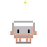
  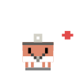
  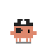
  
  
</p>

Mod de Claude Code que abre un panel llamado «Equipo» al lado del chat. Cada agente que arranca en la sesión aparece como un Clawd vestido de una profesión elegida al azar, sin repetir entre los que trabajan a la vez, con su tarea, su tipo, su modelo, su esfuerzo, sus tokens y su tiempo.

Es un proyecto de la comunidad, sin relación con Anthropic. Clawd es la mascota de Claude.

<p align="center">
  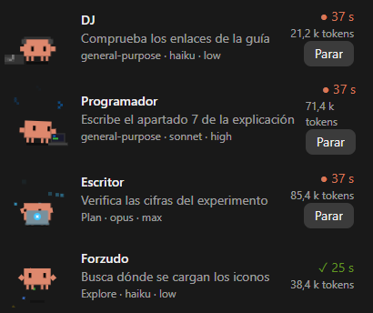
</p>

- Al pie del panel, el consumo, con barras de píxeles que se llenan en verde, en ámbar desde la mitad y en rojo desde el 80 %:
  - cuánto llevas gastado de tus límites de uso de 5 horas y de la semana, y cuándo se renueva cada uno;
  - cuánto ocupa la conversación en el contexto del modelo;
  - y cuánto le queda a la caché de la conversación antes de enfriarse. La caché dura una hora desde la última petición de Claude, salvo en uso extra, por encima de los límites de tu plan, donde dura cinco minutos y el panel no lo sabe. Si se enfría, el próximo mensaje vuelve a cargar toda la conversación, lo que tarda más y consume más de tus límites.
- El botón «🔊 Sonido: sí» de la parte de arriba del panel quita los sonidos, y al pulsarlo otra vez, que dirá «🔇 Sonido: no», los vuelve a poner. También se puede con `/equipo sonido`, que cambia al contrario de como esté, o con `/equipo sonido no` y `/equipo sonido sí`. Lo que elijas se guarda y vale para todas tus sesiones, también las que abras después. Los avisos salen siempre.
- `/equipo demo` llena el panel con cuatro agentes de mentira durante un minuto, sin gastar tokens, para verlo o hacer capturas.
- Los agentes de un workflow se agrupan bajo el nombre del workflow, con su tiempo total y sus tokens.
- El mismo Clawd aparece junto a la fila del chat donde se lanzó el agente.
- El panel se abre solo cuando arranca un agente, y también con la orden `/equipo`, por ejemplo para ver el consumo cuando no hay agentes.
- Cada agente suelto tiene un botón «Parar», y cada workflow, «Parar workflow».

Los tokens de cada agente se cuentan como en el resumen de Claude Code: lo que ocupaba su última petición al modelo, contexto y respuesta.

El sistema de mods de Claude Code está en fase de pruebas y puede cambiar entre versiones.

## Cómo acaba cada agente

<table>
  <tr>
    <td align="center" width="200"><br><b>Termina bien</b><br>Celebra y suena una fanfarria corta de trompeta.</td>
    <td align="center" width="200">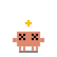<br><b>Falla</b><br>Se marea, con estrellas dando vueltas, y suena un tintineo.</td>
    <td align="center" width="200"><br><b>Lo paras</b><br>Se duerme y suena un tintineo.</td>
  </tr>
</table>

En los tres casos sale además un aviso con la profesión del Clawd y su tarea. La fanfarria y el tintineo están generados por síntesis, sin ningún archivo de terceros. El sonido suena en Windows y en Mac; en Linux, el sistema de mods no tiene reproductor.

## Instalación

En una terminal de Claude Code, escribe en el cuadro de la conversación:

```
/plugin install equipo-clawd --marketplace CristianInBits/equipo-clawd
```

Desde una terminal normal:

```
claude plugin install equipo-clawd --marketplace CristianInBits/equipo-clawd
```

En la app de escritorio, donde `/plugin` no funciona: pulsa el botón + junto al cuadro de texto, después **Plugins**, **Add marketplace** con `CristianInBits/equipo-clawd`, y luego **Add plugin**.

Lo que verás, en orden: la pregunta `Add marketplace?`, que se responde con `y`; los detalles del plugin, donde se elige el ámbito de usuario con Enter; y al final `Installed equipo-clawd. Plugin is now active.` No hace falta cuenta de GitHub.

## Actualizar

Cuando haya una versión nueva, en una terminal normal:

```
claude plugin marketplace update equipo-clawd
```

```
claude plugin update equipo-clawd@equipo-clawd
```

Después escribe `/reload-plugins` en una sesión abierta, o abre una sesión nueva.

## Las 34 profesiones

Cada agente que arranca se viste de una de estas profesiones, elegida al azar, sin repetir entre los que trabajan a la vez.

<table>
  <tr>
    <td align="center"><br>Programador</td>
    <td align="center"><br>Escritor</td>
    <td align="center">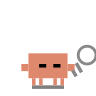<br>Revisor</td>
    <td align="center">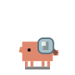<br>Cazabugs</td>
    <td align="center"><br>Tester</td>
    <td align="center">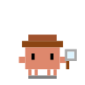<br>Detective</td>
  </tr>
  <tr>
    <td align="center"><br>Cocinero</td>
    <td align="center"><br>Deportista</td>
    <td align="center"><br>Forzudo</td>
    <td align="center"><br>Nadador</td>
    <td align="center">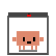<br>Empresario</td>
    <td align="center"><br>Banquero</td>
  </tr>
  <tr>
    <td align="center"><br>Bombero</td>
    <td align="center"><br>Pintor</td>
    <td align="center">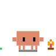<br>Explorador</td>
    <td align="center">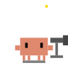<br>Astrónomo</td>
    <td align="center">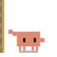<br>Escalador</td>
    <td align="center"><br>Arquitecto</td>
  </tr>
  <tr>
    <td align="center"><br>Astronauta</td>
    <td align="center">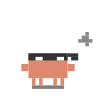<br>Ninja</td>
    <td align="center"><br>Pirata</td>
    <td align="center">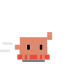<br>Superhéroe</td>
    <td align="center"><br>Mago</td>
    <td align="center">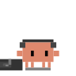<br>DJ</td>
  </tr>
  <tr>
    <td align="center"><br>Fotógrafo</td>
    <td align="center"><br>Jardinero</td>
    <td align="center">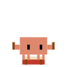<br>Batería</td>
    <td align="center">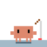<br>Pescador</td>
    <td align="center">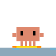<br>Surfista</td>
    <td align="center"><br>Skater</td>
  </tr>
  <tr>
    <td align="center">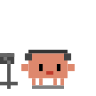<br>Locutor</td>
    <td align="center">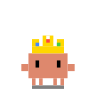<br>Rey</td>
    <td align="center"><br>Médico</td>
    <td align="center"><br>Científico</td>
  </tr>
</table>

Los dibujos, salvo el médico y el científico, que se dibujaron para este mod, son de [clawd-pet](https://github.com/abderrahimghazali/clawd-pet), de Abderrahim GHAZALI, con licencia MIT: ver `LICENSE-clawd-pet.txt`.

## Licencia

El resto del mod, es decir, el código, los sonidos y los dibujos del médico y del científico, tiene licencia MIT: ver `LICENSE`.
